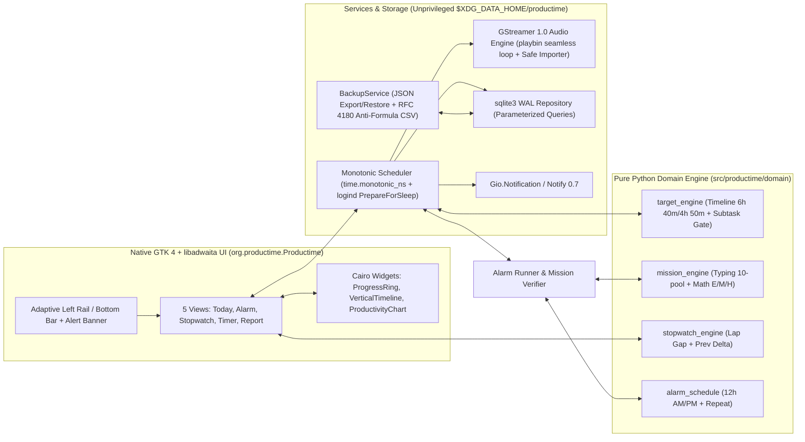

# Implementation Plan: Productime (Native Fedora Linux Desktop)

> Companion documents: [PRD.md](./PRD.md) and [DESIGN.md](./DESIGN.md).
> Verified Host Environment: Fedora Linux 44 (GNOME Wayland), Python `3.14.10`, PyGObject (`Gtk 4.22.5`, `Adw 1.9.4`, `Gst 1.28.9.0` with `playbin`/`mpg123audiodec`/`avdec_mp3`, `Notify 0.7`), `cairo`, `sqlite3 3.51.2`, `/home/reiziqzip/.local/bin/ruff`, `desktop-file-validate`, `gtk4-update-icon-cache`, `magick`. (`g++`, `rpmbuild`, `cargo` not installed.)

---

## 1. Architecture Overview

Productime v1 targets **Fedora Linux Desktop exclusively** (`org.productime.Productime`, GNOME Wayland/X11) and uses an **ultra-lightweight 100% Native Python 3 + GTK 4 + libadwaita + Cairo + GStreamer + `sqlite3`** architecture running strictly in unprivileged user space (`$USER`), with **zero Chromium/Electron/WebKit** overhead and **zero third-party runtime pip dependencies**.

All saved **Targets (and batches/subtasks), Alarms, Timers, Custom Sound metadata, and Reports (`focus_logs`)** automatically persist to disk in `$XDG_DATA_HOME/productime/productime.db` (default `~/.local/share/productime/productime.db`), AND can also be saved/exported or restored to user-chosen `.json` / `.csv` files via native `Gtk.FileDialog`.



---

## 2. Target Repository Structure

```text
Productime/
├── Assets/                              # Existing bundled PNG icon & 6 MP3 alarms (DO NOT rename/delete)
├── PRD.md
├── DESIGN.md
├── IMPLEMENTATION_PLAN.md
├── CLAUDE.md
├── PROMPT_CLAUDE.md
├── pyproject.toml                       # Package config & ruff lint rules (zero external runtime deps)
├── LICENSE                              # MIT License for GitHub release
├── README.md
├── .gitignore
├── .github/workflows/ci.yml             # Fedora container CI: ruff, emdash check, unittest, GTK4 UI test
├── packaging/
│   ├── org.productime.Productime.desktop.in
│   └── rpm/
│       └── productime.spec              # Clean noarch RPM spec using Fedora system Python/GTK4/Gst
├── scripts/
│   ├── run-dev.sh                       # Launch Productime locally during testing: PYTHONPATH=src python3 -m productime
│   ├── check-emdash.py                  # Fails if U+2014 exists in src/, tests/, scripts/, README.md, packaging/
│   ├── install-local.sh                 # Unprivileged installer to ~/.local (no sudo, desktop launcher + icon)
│   └── build-fedora.sh                  # Packages release .tar.gz (+ .rpm if rpmbuild exists) + SHA256SUMS
├── src/
│   └── productime/
│       ├── __init__.py
│       ├── __main__.py                  # Entry point (`python3 -m productime`)
│       ├── app.py                       # Adw.Application, Wayland app_id, single-instance, hide-on-close
│       ├── paths.py                     # XDG paths ($XDG_DATA_HOME/productime) & Assets lookup (dev vs installed)
│       ├── domain/
│       │   ├── __init__.py
│       │   ├── models.py
│       │   ├── validation.py            # Input bounds & JSON backup schema validation
│       │   ├── target_engine.py         # Batch calculation (6h 40m / 4h 50m) + gated state machine
│       │   ├── mission_engine.py        # 30+ curated Typing phrases + Math Easy/Medium/Hard
│       │   ├── stopwatch_engine.py      # Lap split gap + previous delta math
│       │   ├── alarm_schedule.py        # 12h AM/PM <-> 24h & next-ring calculator
│       │   └── formatters.py
│       ├── db/
│       │   ├── __init__.py
│       │   ├── database.py              # sqlite3 WAL connection (0700 dir, 0600 db)
│       │   ├── migrations.py            # Schema creation + bundled sound seeding
│       │   └── repositories.py          # Parameterized CRUD & Day/Week report aggregations
│       ├── services/
│       │   ├── __init__.py
│       │   ├── clock.py                 # Injectable Clock protocol (SystemClock vs FakeClock for tests)
│       │   ├── audio_service.py         # GStreamer 1.0 looping player, preview, & safe custom sound importer
│       │   ├── scheduler_service.py     # Monotonic ticks, alarm checks, PrepareForSleep D-Bus reconciliation
│       │   ├── notification_service.py  # Native desktop notifications with click-to-focus action
│       │   └── backup_service.py        # Save/restore JSON backups + RFC 4180 anti-formula CSV/JSON export
│       └── ui/
│           ├── __init__.py
│           ├── main_window.py           # Adaptive Left Rail / Bottom Bar, alert recovery banner, backup triggers
│           ├── theme.py                 # Adw.StyleManager Light/Dark switch + Gtk.CssProvider loader
│           ├── styles/
│           │   ├── base.css
│           │   ├── light.css
│           │   └── dark.css
│           ├── widgets/
│           │   ├── __init__.py
│           │   ├── progress_ring.py     # Cairo circular countdown ring
│           │   ├── sound_picker.py      # 6 bundled + Gtk.FileDialog audio import + Preview
│           │   └── state_panels.py      # Reusable Empty, Loading, Error panels
│           └── views/
│               ├── target/
│               │   ├── today_view.py
│               │   ├── create_target_dialog.py
│               │   ├── vertical_timeline.py
│               │   ├── focus_target_view.py
│               │   └── subtask_gate_dialog.py
│               ├── alarm/
│               │   ├── alarm_view.py
│               │   ├── create_alarm_dialog.py
│               │   └── alarm_ringing_dialog.py
│               ├── stopwatch/
│               │   └── stopwatch_view.py
│               ├── timer/
│               │   ├── timer_view.py
│               │   ├── create_timer_dialog.py
│               │   └── timer_expired_dialog.py
│               └── report/
│                   ├── report_view.py
│                   └── productivity_chart.py
└── tests/
    ├── unit/
    │   ├── test_target_engine.py
    │   ├── test_mission_engine.py
    │   ├── test_stopwatch_engine.py
    │   ├── test_alarm_schedule.py
    │   ├── test_validation.py
    │   └── test_contrast.py             # Parses light.css/dark.css & asserts WCAG AA contrast ratios
    ├── integration/
    │   ├── test_database.py
    │   ├── test_backup_service.py
    │   ├── test_audio_security.py
    │   └── test_scheduler.py
    └── ui/
        └── test_gtk_app.py              # Native GTK 4 widget/app flow verification + RSS memory check
```

---

## 3. SQLite Database Schema (`src/productime/db/migrations.py`)

Use Python built-in `sqlite3` with `PRAGMA journal_mode = WAL;` and `PRAGMA foreign_keys = ON;`. Every query MUST use bound `?` parameters cleanly.

```sql
CREATE TABLE IF NOT EXISTS sounds (
  id TEXT PRIMARY KEY,
  display_name TEXT NOT NULL,
  source_type TEXT NOT NULL CHECK (source_type IN ('bundled', 'custom')),
  file_path TEXT NOT NULL,
  duration_seconds REAL DEFAULT 0,
  created_at TEXT NOT NULL DEFAULT (datetime('now'))
);

CREATE TABLE IF NOT EXISTS targets (
  id TEXT PRIMARY KEY,
  name TEXT NOT NULL,
  tag_label TEXT NOT NULL DEFAULT 'Study',
  tag_color TEXT NOT NULL DEFAULT 'purple',
  target_total_minutes INTEGER NOT NULL CHECK (target_total_minutes >= 1),
  work_minutes INTEGER NOT NULL CHECK (work_minutes >= 1),
  short_break_minutes INTEGER NOT NULL CHECK (short_break_minutes >= 0),
  long_rest_enabled INTEGER NOT NULL DEFAULT 0,
  long_rest_every INTEGER NOT NULL DEFAULT 3 CHECK (long_rest_every >= 1),
  long_rest_minutes INTEGER NOT NULL DEFAULT 30 CHECK (long_rest_minutes >= 1),
  snooze_limit INTEGER NULL, -- NULL = Unlimited, otherwise 1, 2, 3, 5, 10
  sound_id TEXT NOT NULL REFERENCES sounds(id),
  status TEXT NOT NULL DEFAULT 'planned' CHECK (status IN ('planned', 'in_progress', 'completed')),
  created_at TEXT NOT NULL DEFAULT (datetime('now')),
  updated_at TEXT NOT NULL DEFAULT (datetime('now'))
);

CREATE TABLE IF NOT EXISTS target_batches (
  id TEXT PRIMARY KEY,
  target_id TEXT NOT NULL REFERENCES targets(id) ON DELETE CASCADE,
  batch_index INTEGER NOT NULL CHECK (batch_index >= 1),
  subtask_title TEXT NOT NULL,
  planned_work_minutes INTEGER NOT NULL CHECK (planned_work_minutes >= 1),
  planned_break_minutes INTEGER NOT NULL CHECK (planned_break_minutes >= 0),
  break_type TEXT NOT NULL CHECK (break_type IN ('none', 'short', 'long')),
  status TEXT NOT NULL DEFAULT 'pending' CHECK (status IN ('pending', 'active', 'completed', 'skipped')),
  actual_work_seconds INTEGER NOT NULL DEFAULT 0,
  snooze_seconds_used INTEGER NOT NULL DEFAULT 0,
  snooze_count INTEGER NOT NULL DEFAULT 0,
  completed_at TEXT NULL,
  UNIQUE(target_id, batch_index)
);

CREATE TABLE IF NOT EXISTS alarms (
  id TEXT PRIMARY KEY,
  name TEXT NOT NULL,
  hour_24 INTEGER NOT NULL CHECK (hour_24 BETWEEN 0 AND 23),
  minute INTEGER NOT NULL CHECK (minute BETWEEN 0 AND 59),
  repeat_days_json TEXT NOT NULL DEFAULT '[]', -- e.g. [1,2,3,4,5] (1=Mon..7=Sun consistently)
  sound_id TEXT NOT NULL REFERENCES sounds(id),
  snooze_interval_minutes INTEGER NOT NULL DEFAULT 5 CHECK (snooze_interval_minutes IN (1,5,10,15,20,25,30)),
  snooze_limit INTEGER NULL, -- NULL = Unlimited
  mission_mode TEXT NOT NULL DEFAULT 'off' CHECK (mission_mode IN ('off', 'typing', 'math')),
  mission_count INTEGER NOT NULL DEFAULT 1 CHECK (mission_count BETWEEN 1 AND 3),
  mission_difficulty TEXT NOT NULL DEFAULT 'easy' CHECK (mission_difficulty IN ('easy', 'medium', 'hard')),
  enabled INTEGER NOT NULL DEFAULT 1,
  created_at TEXT NOT NULL DEFAULT (datetime('now'))
);

CREATE TABLE IF NOT EXISTS timers (
  id TEXT PRIMARY KEY,
  name TEXT NOT NULL,
  duration_seconds INTEGER NOT NULL CHECK (duration_seconds >= 1),
  sound_id TEXT NOT NULL REFERENCES sounds(id),
  created_at TEXT NOT NULL DEFAULT (datetime('now'))
);

CREATE TABLE IF NOT EXISTS focus_logs (
  id TEXT PRIMARY KEY,
  source_type TEXT NOT NULL CHECK (source_type IN ('target_batch', 'timer')),
  target_id TEXT NULL,
  batch_id TEXT NULL,
  title TEXT NOT NULL,
  tag_label TEXT NOT NULL DEFAULT 'Focus',
  started_at TEXT NOT NULL,
  ended_at TEXT NOT NULL,
  duration_seconds INTEGER NOT NULL CHECK (duration_seconds >= 0),
  subtask_completed INTEGER NOT NULL DEFAULT 0,
  local_date_key TEXT NOT NULL -- YYYY-MM-DD in user's local timezone
);

CREATE TABLE IF NOT EXISTS app_preferences (
  key TEXT PRIMARY KEY,
  value TEXT NOT NULL
);
```

### Bundled Sound Seeding IDs
Store relative filename only (resolved safely against `paths.assets_dir()` at runtime):
- `bundled-8footdino` -> `8footdino_on_scratch-alarm.mp3`
- `bundled-biohazard` -> `biohazard-alarm.mp3`
- `bundled-community` -> `community-alarm.mp3`
- `bundled-digital` -> `digital-alarm-clock.mp3`
- `bundled-funny` -> `funny-alarm.mp3`
- `bundled-lofi` -> `lo-fi-alarm-clock.mp3`

---

## 4. Core Domain Algorithms

### A. Target Vertical Timeline Formula (`src/productime/domain/target_engine.py`)
1. `total = target_hours * 60 + target_minutes` (`>= 1`).
2. `cycle = work_minutes + short_break_minutes`.
3. `full_cycles = total // cycle`, `remainder = total % cycle`.
4. Build `batch_work_list`:
   - `full_cycles` batches of `work_minutes`.
   - If `remainder > 0`, append 1 final batch of `max(1, min(work_minutes, remainder))`.
   - If `batch_work_list` is empty (`total < cycle`), push 1 batch of `min(work_minutes, total)`.
5. Assign break slots uniformly for every batch index `i` (`1..N`, including the final batch):
   - If `long_rest_enabled and i % long_rest_every == 0`: `break_type = "long"`, `break_minutes = long_rest_minutes`.
   - Else if `short_break_minutes > 0`: `break_type = "short"`, `break_minutes = short_break_minutes`.
   - Else: `break_type = "none"`, `break_minutes = 0`.
6. Compute cumulative minutes `[cumulative_start_minute, cumulative_end_minute]` sequentially across work + break slots.
   - Verified Example 1 ("Website Profile Company", `6h`, `50/10`, `30m every 3`):
     - `B1: 0-50 (break 50-60)` (`Membuat PRD`)
     - `B2: 60-110 (break 110-120)` (`Membuat desain`)
     - `B3: 120-170 (long rest 170-200)` (`Coding backend`)
     - `B4: 200-250 (break 250-260)` (`Coding database dan frontend`)
     - `B5: 260-310 (break 310-320)` (`Security dan deploy`)
     - `B6: 320-370 (long rest 370-400)` (`Finish selesai semua`) -> **Total `400m` = `6h 40m`**.
   - Verified Example 2 ("Belajar Pemrograman Mobile", `4h`, `25/5`, `30m every 4`):
     - `B1: 0-25 (break 25-30)` (`Belajar fundamental pemrograman mobile`)
     - `B2: 30-55 (break 55-60)` (`Membuat JavaScript`)
     - `B3: 60-85 (break 85-90)` (`Coding JavaScript`)
     - `B4: 90-115 (long rest 115-145)` (`Coding XML`)
     - `B5: 145-170 (break 170-175)` (`Belajar coding JavaScript tingkat lanjut`)
     - `B6: 175-200 (break 200-205)` (`Belajar Flutter`)
     - `B7: 205-230 (break 230-235)` (`Belajar deploy dan menggunakan Android Studio`)
     - `B8: 235-260 (long rest 260-290)` (`Finish`) -> **Total `290m` = `4h 50m`**.
7. **State Machine Invariants**:
   - `resting` can ONLY be reached through `COMPLETE_SUBTASK`.
   - On the final batch `i === N`, `COMPLETE_SUBTASK` transitions to final `resting` (if `break_minutes > 0`) where `FINISH_TARGET` / `SKIP_FINAL_REST` completes the target cleanly (or directly to `completed` if `break_minutes == 0`).

### B. Stopwatch Lap Gap Calculation (`src/productime/domain/stopwatch_engine.py`)
When recording Lap `k` at `total_elapsed_ms`:
- `prev_total_ms = 0 if k == 1 else laps[k - 2].total_elapsed_ms`
- `lap_split_ms = total_elapsed_ms - prev_total_ms` (exact gap between Lap `k-1` and Lap `k`)
- `delta_vs_prev_ms = None if k == 1 else lap_split_ms - laps[k - 2].lap_split_ms`

### C. Mission Engine (`src/productime/domain/mission_engine.py`)
- **Typing**: Curated static pool of 30+ meaningful study/dev phrases. When an alarm session starts, pick up to 10 distinct phrases (`len(session_pool) <= 10`) using injectable RNG and present `mission_count` (`1..3`) phrases sequentially. Block clipboard paste and multi-character paste insertion on the `Gtk.Entry`.
- **Math**: Random generator supporting `1..3` questions:
  - `easy`: `+` or `-` (`10..99`, ensure `a >= b` for subtraction).
  - `medium`: `+`, `-` (`20..250`, `a >= b`), or `*` (`4..19 * 3..15`).
  - `hard`: `+`, `-` (`150..999`, `a >= b`), `*` (`12..49 * 12..39`), or `a * b + c` (`8..25 * 6..19 + 25..150`).

---

## 5. Security & Reliability Checklist (Native Linux Desktop)

1. **No Pango Markup Injection**: Always set user-supplied strings (`target_name`, `subtask_title`, `alarm_name`, `sound_display_name`, `file_name`) with `set_text()` / `set_label()`, NEVER `set_markup()`.
2. **Audio Import & Playback Safety**:
   - File paths originate strictly from native `Gtk.FileDialog` (or tested service parameter), verified via `os.path.realpath()` and `stat.S_ISREG()`.
   - Enforce extension allowlist (`.mp3`, `.wav`, `.ogg`, `.flac`, `.m4a`), `50 MB` size cap, and binary magic-byte header verification before copying to `$XDG_DATA_HOME/productime/sounds/<uuid>.<ext>` (`0600`).
   - Playback resolves sound IDs strictly from DB (`bundled-*` under `Assets/`, `custom-*` under `XDG_DATA_HOME/productime/sounds/`), converted safely via `Gst.filename_to_uri()`. Zero shell subprocesses.
3. **Parameterized SQLite & Atomic File Persistence**: Use `?` parameter binding exclusively; enforce directory `0700` and DB `0600`. JSON backups validated strictly before transactional restore; orphaned custom sound IDs fall back to `bundled-digital`.
4. **CSV Formula Injection Protection**: Quote CSV fields per RFC 4180 and prepend `'` to values beginning with `=`, `+`, `-`, `@`, `\t`, or `\r`.
5. **Least Privilege Linux**: Zero `sudo`, zero SUID helpers, zero root systemd services, and zero external internet requests.

---

## 6. Phased Execution Plan

1. **Phase 1: Bootstrap & Foundation**: Create `pyproject.toml`, `scripts/check-emdash.py`, `scripts/run-dev.sh`, `src/productime/paths.py`, skeleton `Adw.Application` (`org.productime.Productime`), `theme.py` + `base.css`/`light.css`/`dark.css`, and empty shell window. Verify startup & `ruff`.
2. **Phase 2: Pure Domain Engines + Unit Tests (TDD)**: Implement `models.py`, `validation.py`, `target_engine.py`, `mission_engine.py`, `stopwatch_engine.py`, `alarm_schedule.py`, `formatters.py`, plus `tests/unit/*` (including `test_contrast.py` validating CSS WCAG AA contrast). Run `unittest`.
3. **Phase 3: SQLite, GStreamer Audio, Scheduler, Notifications, Backup + Integration Tests**: Implement `database.py`, `migrations.py`, `repositories.py`, `audio_service.py`, `scheduler_service.py`, `notification_service.py`, `backup_service.py`. Run `tests/integration/*` verifying persistence, sleep/wake clock delta, audio security, and backup/CSV safety.
4. **Phase 4: Native GTK 4 + libadwaita + Cairo UI (`antislop: DURING`)**: Build `main_window.py`, custom Cairo widgets (`progress_ring.py`, `vertical_timeline.py`, `productivity_chart.py`), shared `sound_picker.py` & `state_panels.py`, and all 5 features (`Today/Target`, `Alarm`, `Stopwatch`, `Timer`, `Report`) with Light/Dark support, `Escape` handling (alert recovery bar on Gate/Ringing), and keyboard focus.
5. **Phase 5: Fedora Linux Integration & Packaging**: Add `packaging/org.productime.Productime.desktop.in`, `packaging/rpm/productime.spec`, `scripts/install-local.sh` (unprivileged copy to `~/.local/share/productime-app/` + `~/.local/bin/productime` + icon + `.desktop` + cache refresh + `--uninstall`), `scripts/build-fedora.sh`, `README.md`, `LICENSE` (MIT), and `.github/workflows/ci.yml`.
6. **Phase 6: Verification Gate (Native Desktop Only)**: Run `ruff check`, `python3 scripts/check-emdash.py`, all `unittest` suites (`unit`, `integration`, native GTK 4 `ui`), `desktop-file-validate`, `scripts/install-local.sh` test in scratch `HOME`, `scripts/build-fedora.sh`, measure live process RSS RAM (`ps -o rss=`), and run the full `antislop` Delivery Gate before reporting completion.

---

## 7. Verification Commands (Native Desktop, Zero Browser Needed)

```bash
ruff check src tests scripts
python3 scripts/check-emdash.py
python3 -m unittest discover -s tests/unit -v
python3 -m unittest discover -s tests/integration -v
python3 -m unittest discover -s tests/ui -v
```

---

## 8. Standalone GNOME Launcher (Final Stage After Stabilization)

During terminal testing, run via `./scripts/run-dev.sh`. Once verified stable, launch Productime directly from the Fedora GNOME App Grid / Dash without opening any terminal:

1. **GNOME Wayland Window-to-Icon Matching**:
   - `Adw.Application(application_id="org.productime.Productime")`, `GLib.set_prgname("org.productime.Productime")`, `GLib.set_application_name("Productime")`.
   - Register icon search path in dev and install `Assets/Productime Icon.png` to `~/.local/share/icons/hicolor/512x512/apps/org.productime.Productime.png`.
2. **Unprivileged Local Desktop Installer (`scripts/install-local.sh`)**:
   - Copies application source + `Assets/` cleanly into `~/.local/share/productime-app/` (so launcher stays self-contained).
   - Writes launcher executable `~/.local/bin/productime` (`chmod 755`).
   - Writes `~/.local/share/applications/org.productime.Productime.desktop` (`Name=Productime`, `Terminal=false`, `Icon=org.productime.Productime`, `StartupWMClass=org.productime.Productime`, `Categories=Utility;Clock;Education;`), validates via `desktop-file-validate`, and refreshes desktop & icon caches (`update-desktop-database` / `gtk4-update-icon-cache`).
