<div align="center">

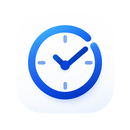

# Productime

**Focus targets, alarms that make you get up, timers with your own music, and a weekly report.**<br>
An open source, native desktop app for Fedora Linux.

[](https://fedoraproject.org/workstation/)
[](https://www.gnome.org/)
[](https://www.python.org/)
[](https://www.gtk.org/)
[](https://gstreamer.freedesktop.org/)
[](https://www.sqlite.org/)
<br>
[](#open-source-and-license)
[](LICENSE)
[](https://github.com/HikariReiziq/Productime/actions/workflows/ci.yml)


</div>

## Background and problem

Students and developers who move to Fedora for study and coding lean on the clock app all day, and
GNOME Clocks falls short for long focus sessions:

- **No custom sounds.** Alarms and timers cannot play your own music or audio files.
- **Easy to miss.** A finished timer chimes once and goes quiet, so it slips past while you are deep
  in code or away from the desk.
- **No link between time and work.** There are no Pomodoro batches, no long rests, no rule that a
  task is done before the break, and no record of what you actually finished.
- **Heavy alternatives.** Most focus apps are Electron or web apps that take hundreds of MB of RAM
  next to an IDE, an Android emulator, and a browser.

## Solution

Productime puts five tools in one small native window:

| Tool | What it does |
|---|---|
| **Today / Target** | Split a goal (say 6 hours) into Pomodoro batches (`25/5`, `50/10`, or custom) with a long rest every N batches. Give each batch one subtask and watch a live timeline (`6h` becomes `6h 40m` with rests). A batch moves to its break only after you check off its subtask, and the snooze limit is enforced. |
| **Alarm** | Repeat days, your own sound looping until you act, snooze interval and limit, and one wake-up mission: type phrases exactly (pasting is blocked) or solve math at Easy, Medium, or Hard. |
| **Stopwatch** | `Start / Lap`, `Pause / Lap`, `Resume / Clear`, with the gap between laps and the change against the previous lap. |
| **Timer** | Hours, minutes, and seconds with your own music that loops until you stop it. |
| **Report** | Completed subtasks and focus time per day or week, an interactive chart, and CSV or JSON export. |

Creating or editing an item opens a full page beside the navigation rail, the way a phone clock app
does. Details such as snooze, missions, long rests, and custom categories open small sheets with
Cancel and Save. Icons carry the meaning, and hovering any of them shows what it does.

## Screenshots

| Today | Create Target |
|---|---|
| 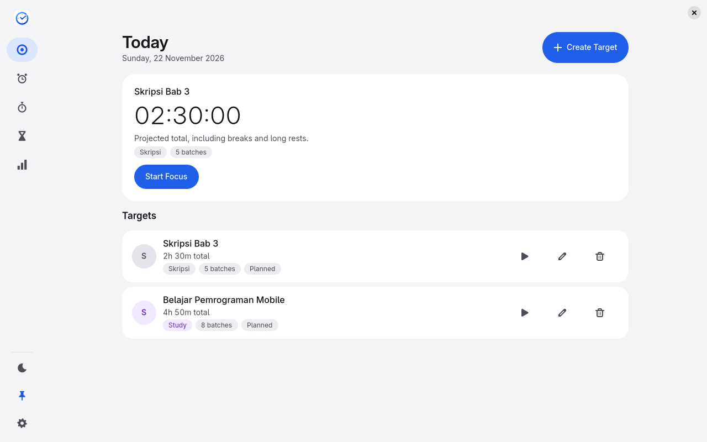 | 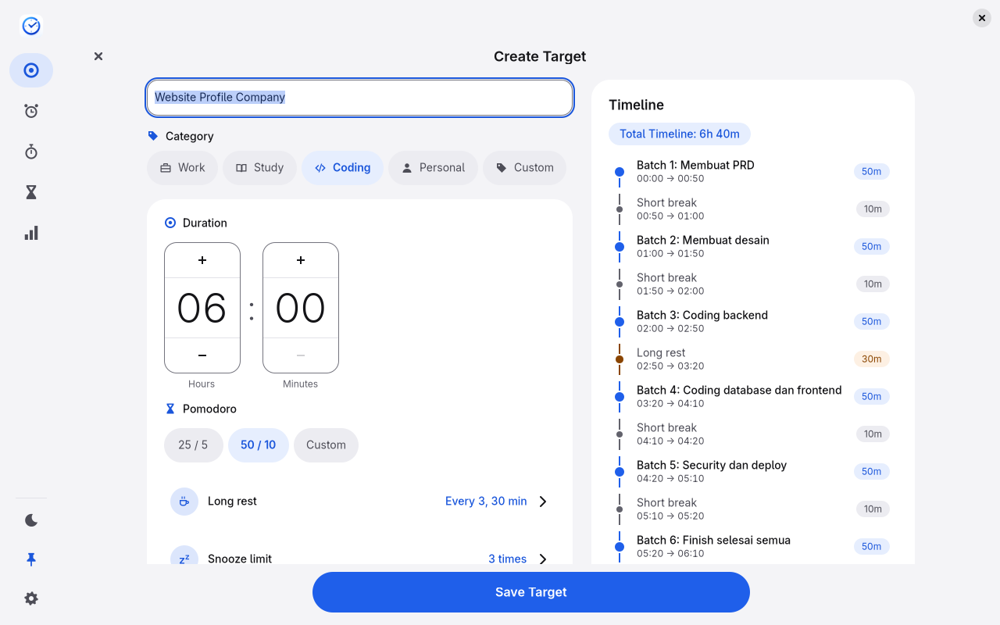 |
| **Focus session (dark)** | **Weekly report** |
| 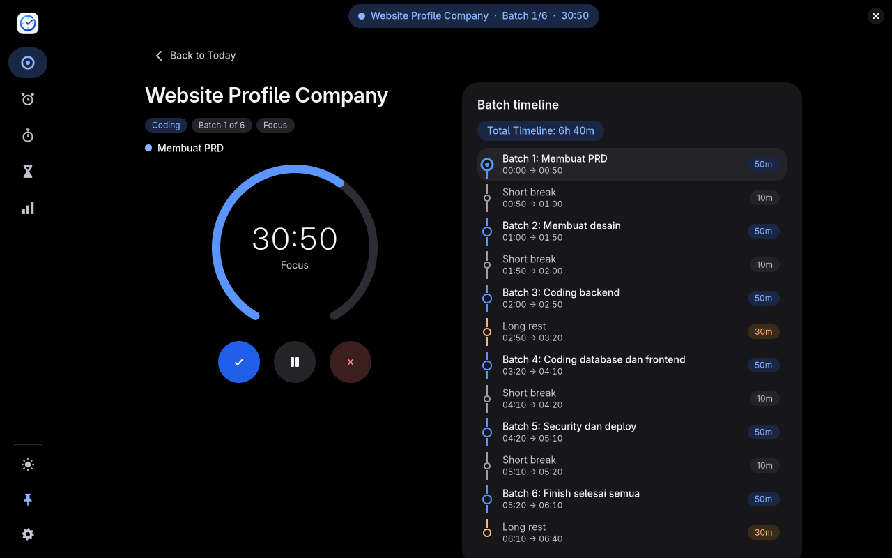 | 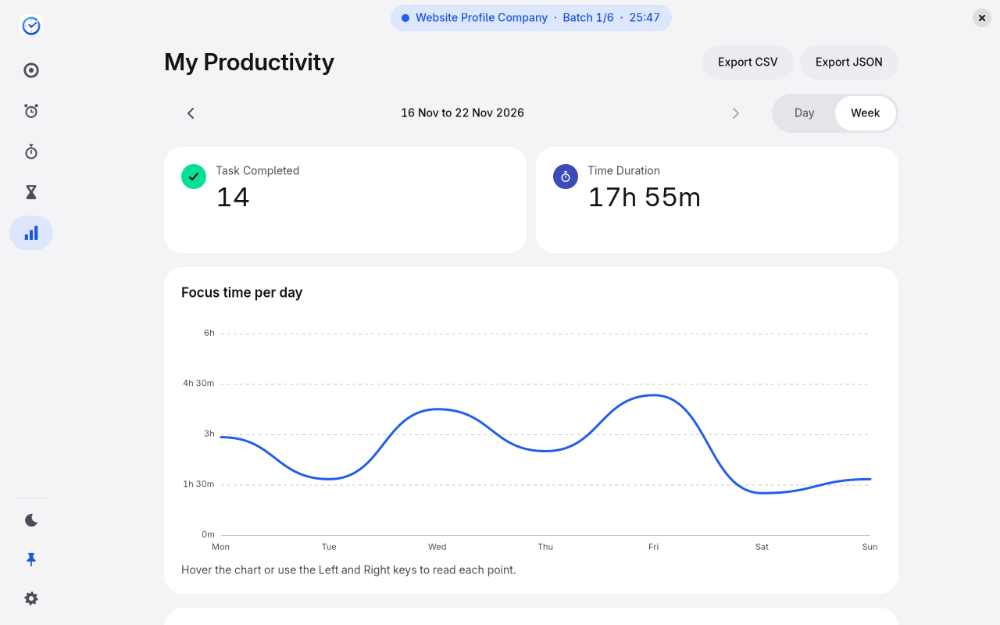 |
| **New Alarm** | **Wake-up mission (dark)** |
| 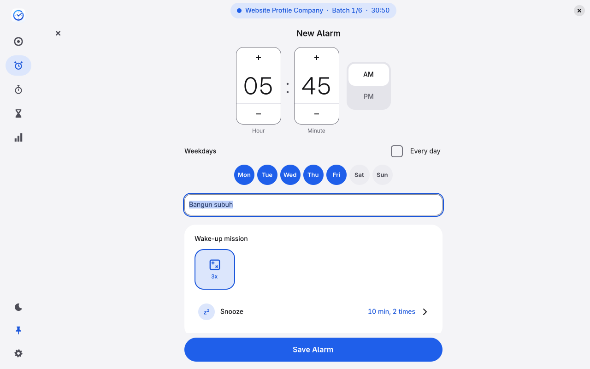 | 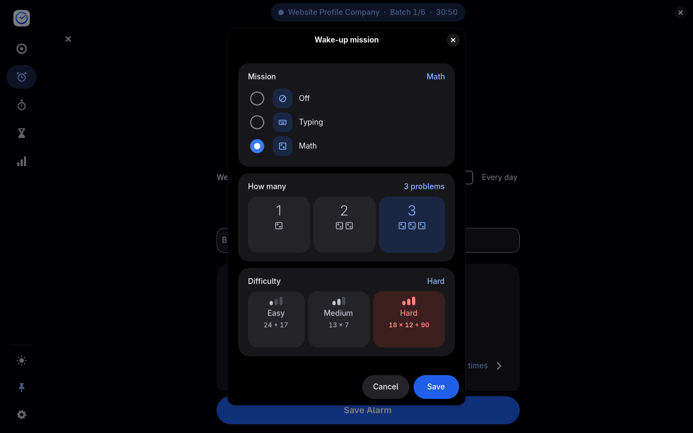 |
| **Snooze** | **Stopwatch (dark)** |
| 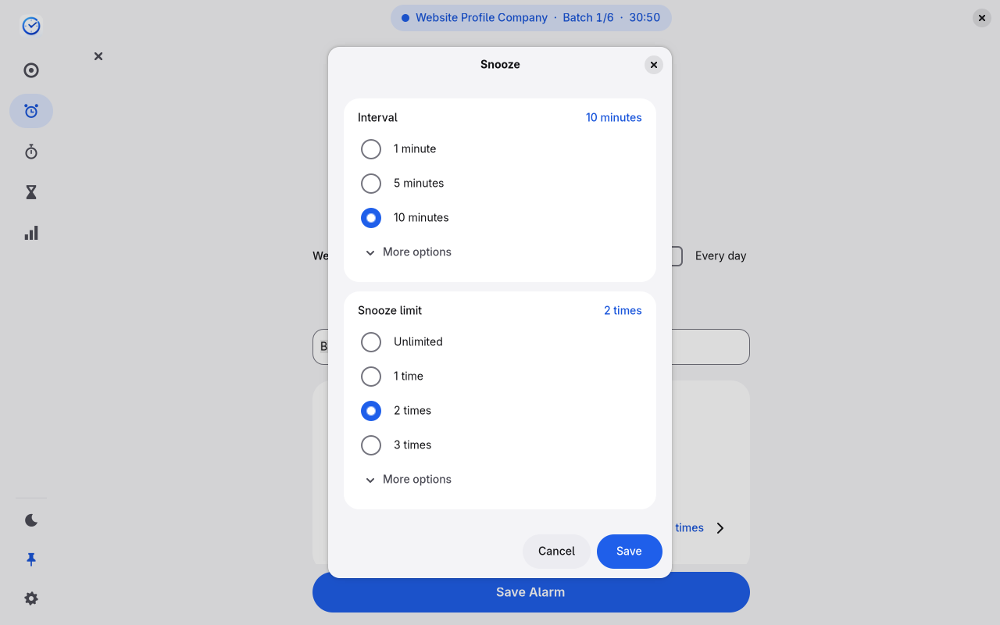 | 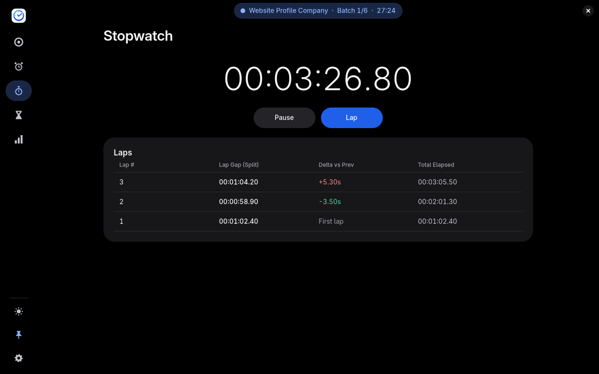 |
| **Timer** | **Settings (dark)** |
| 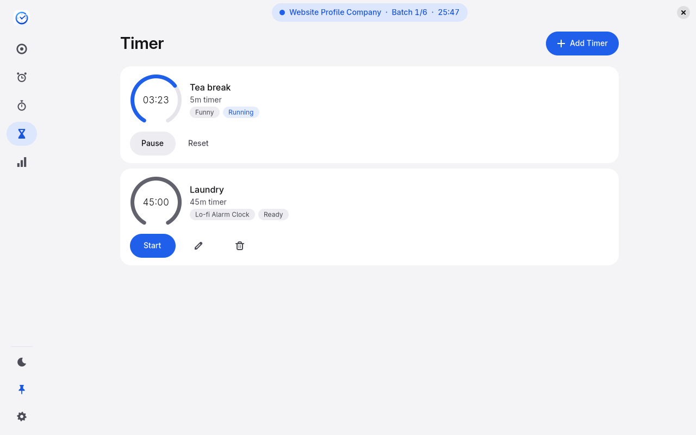 | 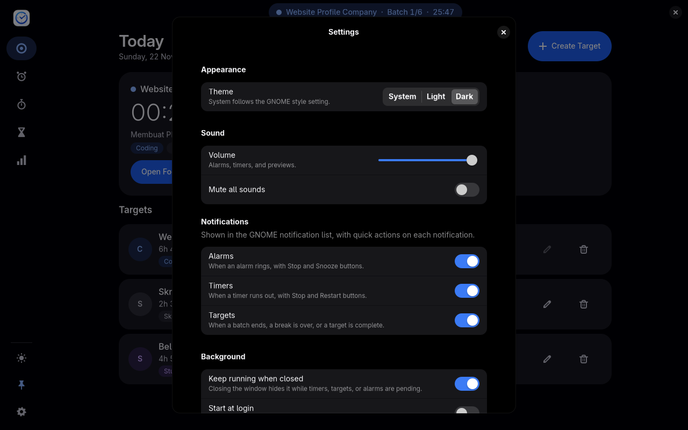 |
| **Welcome** | **Narrow window, 420 px** |
| 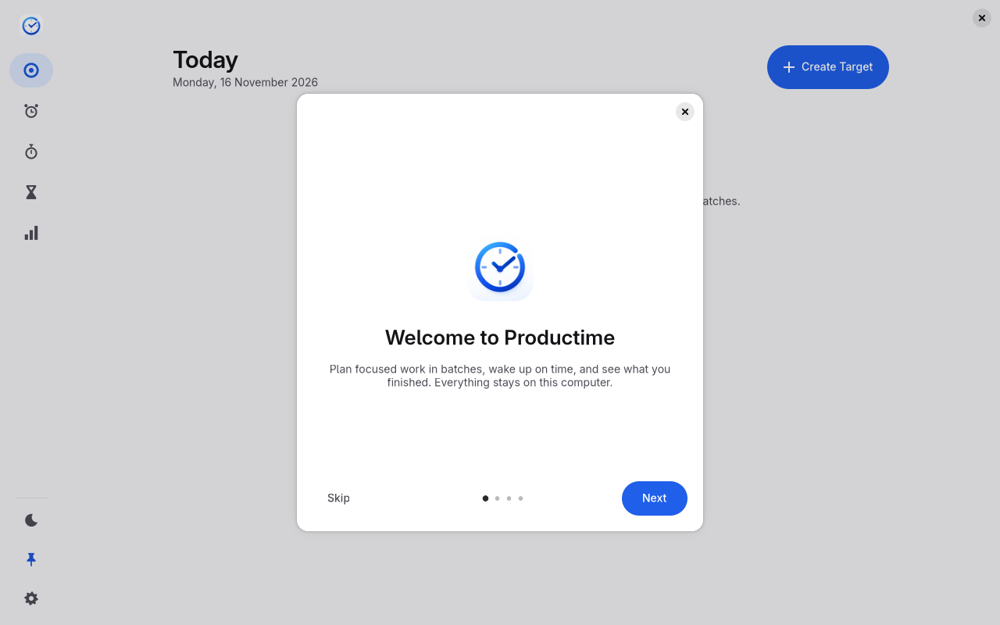 | 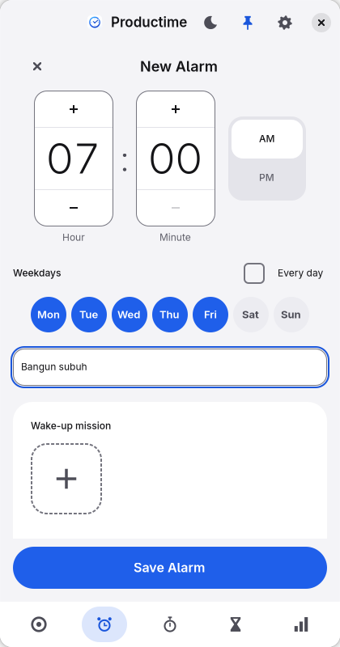 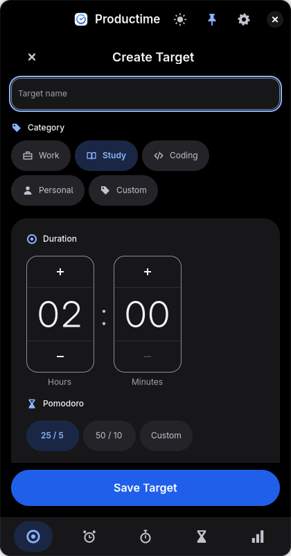 |

## Tech stack

| Layer | Technology | Why |
|---|---|---|
| Language | Python 3.14, standard library only | Ships with Fedora; nothing to `pip install` |
| Interface | GTK 4 and libadwaita through PyGObject | Native GNOME look, adaptive from 420 px to wide screens |
| Styling | GTK CSS with light and dark tokens | Both themes checked against WCAG AA by the tests |
| Drawing | Cairo | Countdown ring, batch timeline, report chart |
| Audio | GStreamer `playbin` | Seamless in-process looping, released when silent |
| Storage | SQLite in WAL mode | One local file, parameterized queries only |
| Desktop | Gio notifications, D-Bus, systemd-logind, XDG autostart | Notification buttons, Activities search, sleep-aware timers, start at login |
| Quality | `unittest`, `ruff`, headless mutter session | 354 tests, including a UI suite that drives the real app |

No browser engine, no Electron, no Node.

## Benefits

- **Light.** An idle window uses about 90 MB of RAM (`ps -o rss=` on Fedora 44), and nothing
  repaints while it is hidden.
- **Hard to miss.** Sounds loop until you respond, snooze has a limit, and a mission makes sure you
  are awake before an alarm stops.
- **Honest focus.** Breaks start only after you check off the subtask, and the report shows only
  work you really finished.
- **Private.** Everything stays in a local SQLite file. Back it up to JSON, restore it, or export the
  report to CSV with spreadsheet formula protection.
- **At home in GNOME.** Notification buttons, dock quick actions, Activities search, start at login,
  and light and dark themes.
- **Accessible.** Full keyboard use, tooltips and screen reader names on every icon, and AA contrast.

## Get started

You need Fedora Workstation 44 or newer. Everything below is part of a default GNOME install:

```bash
sudo dnf install python3-gobject gtk4 libadwaita gstreamer1-plugins-good python3-cairo libnotify
```

Run it straight from a checkout:

```bash
git clone https://github.com/HikariReiziq/Productime.git
cd Productime
./scripts/run-dev.sh
```

Or install a launcher for the GNOME app grid. The installer never uses `sudo`:

```bash
./scripts/install-local.sh              # install to ~/.local
./scripts/install-local.sh --uninstall  # remove it again, your data is kept
```

## Your data

```
~/.local/share/productime/productime.db   targets, subtasks, alarms, timers, report log
~/.local/share/productime/sounds/         audio files you imported
```

The folder is readable only by you. **Settings > Data and Backup** saves everything to one `.json`
file, restores it after a full check, or opens the folder. A backup holds your data but not imported
audio files; a missing custom sound falls back to the default alarm.

## GNOME integration

- **Notifications** carry buttons: Stop (or Open Mission) and Snooze for alarms, Stop and Restart for
  timers, Check Off and Snooze 5 min for a finished batch. Snooze disappears once its limit is used.
- **Start at login** starts Productime hidden; the window opens only when something needs you.
- **Dock quick actions**: right-click the icon for New Target, New Alarm, New Timer, and Start
  Stopwatch.
- **Activities search**: type the name of a saved target or timer and start it from the result. Log
  out and back in once after installing for the search provider to appear.

Closing the window while something is running hides it instead of quitting; `Ctrl+Q` quits.

## Keyboard

| Keys | Action |
|---|---|
| `Ctrl+1` to `Ctrl+5` | Today, Alarm, Stopwatch, Timer, Report |
| `Ctrl+N` | Create a target, alarm, or timer in the current view |
| `Tab`, `Shift+Tab`, `Enter`, `Space` | Move between and activate controls |
| `Escape` | Close a sheet, dialog, or Create page without saving |
| `Left`, `Right`, `Home`, `End` | Read the points of the report chart |
| `Ctrl+Q` | Quit |

`Escape` never silences a ringing alarm, an expired timer, or a batch waiting for check-off. It
collapses the alert to a bar at the top, and the sound keeps looping until you deal with it.

## Development

```bash
ruff check src tests scripts
python3 scripts/check-emdash.py
python3 -m unittest discover -s tests/unit -v
python3 -m unittest discover -s tests/integration -v
scripts/run-ui-tests.sh        # real GTK app in a private headless Wayland session
scripts/build-fedora.sh        # source tarball, SHA256SUMS, and an RPM when rpmbuild is present
```

```
src/productime/domain/     pure logic: timeline math, session state machine, missions, validation
src/productime/db/         SQLite schema and parameterized queries
src/productime/services/   audio, scheduler, notifications, backup, GNOME integration
src/productime/ui/         GTK 4 / libadwaita window, pages, sheets, and Cairo widgets
```

## Known limits

- The interface is in English.
- The style follows One UI conventions; Samsung's own font is not included.
- The typing mission accepts one character per key press, so input methods that commit several
  characters at once are treated like a paste.
- Alarms ring only while Productime runs. Turn on **Start at login** to keep that true after a
  restart.

## Open source and license

Productime is open source. The code is released under the [MIT License](LICENSE): you may use,
study, change, and share it. Issues and pull requests are welcome.

The app icon and the alarm sounds in `Assets/` were supplied by the project owner and are not
covered by the MIT License. Check their own terms before redistributing them.
